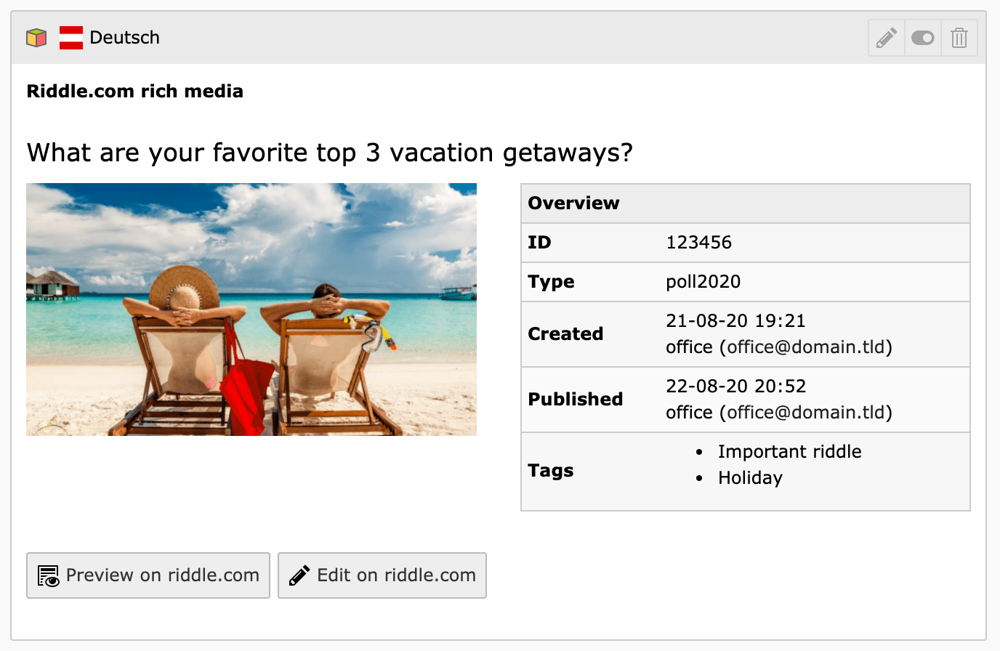
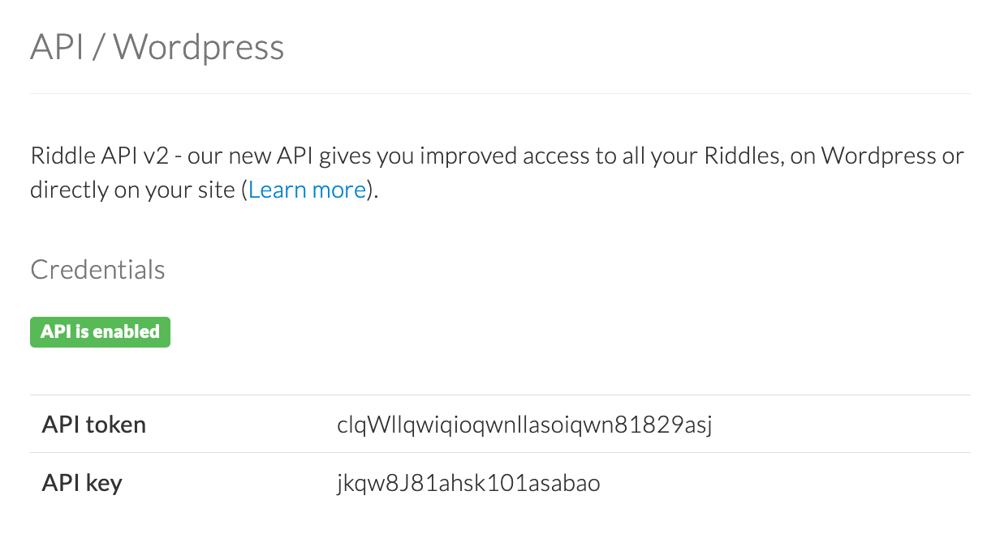
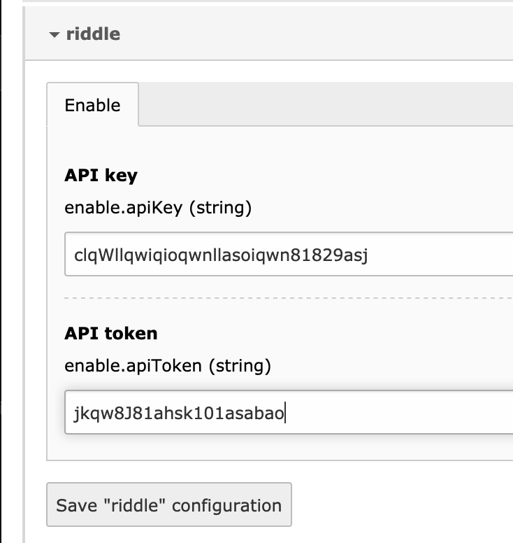

# TYPO3 Extension `riddle`

[](https://github.com/studiomitte/riddle/actions/workflows/ci.yml)

This extension embeds rich media from [riddle.com](https://www.riddle.com)



## Compatibility

| Version | TYPO3 | PHP       |
|---------|-------|-----------|
| 3.x     | 14    | 8.2 - 8.5 |
| 2.x     | 12    | 8.1 - 8.2 |

### Upgrading from 2.x

Since 3.0 the plugin is a content element type of its own (`CType = riddle_riddle`) instead of a
`list_type` plugin. After updating, run the upgrade wizard *"Migrate riddle plugins to content elements"*
(`vendor/bin/typo3 upgrade:run riddlePluginListTypeToCTypeUpdate`). If you customized the rendering,
move your TypoScript from `tt_content.list.20.riddle_riddle` to `tt_content.riddle_riddle.20`.

## Installation

Install the extension as any other extension.
Either use `composer require studiomitte/riddle` or by downloading it from the [TYPO3 Extension Repository](https://extensions.typo3.org/extension/riddle).

Now switch to the [riddle.com account page](https://www.riddle.com/creator/account/api), enable the API and copy the **API token** and **API key**.



Open *Admin Tools > Settings > Extension Configuration > riddle* and paste the API key there.



## Usage

After creating and publishing a riddle on [riddle.com](https://www.riddle.com) you can create a new plugin in TYPO3 **Riddle.com rich media**.

Now you are done.

## GDPR

riddle.com is hosting their riddles on their own servers in Germany and don't save any personal data of users.

Therefore you are not required to ask your website users for permissions displaying the iframe.

## Modify rendering

The rendering is controlled with the TypoScript registered in `ext_localconf.php` which is loaded by default.

```typo3_typoscript
tt_content.riddle_riddle =< lib.contentElement
tt_content.riddle_riddle {
    templateName = Generic
    20 = USER
    20.userFunc = StudioMitte\Riddle\Controller\PluginController->run
}
```

If you want to adopt the rendering, override the `userFunc` and provide a custom entrypoint.

## Credits
This extension was created by Georg Ringer for [Studio Mitte, Linz](https://studiomitte.com) with ♥.

[Find more TYPO3 extensions we have developed](https://www.studiomitte.com/loesungen/typo3) that provide additional features for TYPO3 sites.
